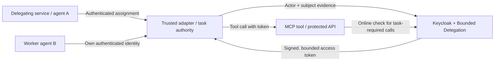

# Keycloak Bounded Delegation

[](https://github.com/Alien6-Studio/keycloak-bounded-delegation/actions/workflows/ci.yml)
[](LICENSE)
[](CONTRIBUTING.md)
[](compatibility.json)
[](docs/support-policy.md)
[](https://github.com/Alien6-Studio/keycloak-bounded-delegation/releases/tag/v0.1.0)

Identity and bounded delegation for **agentic infrastructure**, built on
Keycloak's software service accounts.

Keycloak authenticates each agent or workload under its own identity. This
extension lets one act on behalf of another with **bounded permissions, audience,
lifetime and delegation depth**. A protected tool or API can distinguish who is
acting, for whom, and which operations the resulting token permits.

This is an independent Apache-2.0 extension maintained by Alien6 Studio. We are
preparing a focused contribution to native Keycloak; no upstream proposal has
been submitted or accepted. [Read the integration plan](docs/upstream-proposal.md).

## What it brings to agentic infrastructure

An orchestrator, a worker agent and a tool server have different responsibilities
and need distinct identities and permissions. Authenticating a worker establishes
its identity; a delegated tool call also needs a verified relationship to the
software principal whose authority it exercises. This extension provides that
relationship and enforces its limits at token issuance:

- **Distinct software identities.** Use native Keycloak clients and service
  accounts for agents, workers and protected services. The extension verifies
  separate actor and delegating subject identities against their current native
  bindings. Account provisioning and authentication remain with Keycloak.
- **Permission limited to the requested work.** Delegated resource/scope
  permissions must be allowed by both input tokens, current native authorization
  policies and an explicit grant. The output targets one tool or API audience,
  with bounded expiry and depth.
- **Who acts for whom.** The signed token preserves the subject and the acting
  identity in `act`, including inherited actor history when software delegation
  chains. Receivers can verify the delegation relationship as well as the caller.
- **Optional approval for a particular task.** A trusted task authority binds an
  approval to the exact actor/subject inputs, audience, permissions and operation
  parameters. Approval is single-use for issuance; the protected recipient checks
  the task online before each operation, including cancellation and current policy.

For example, an orchestrator can delegate reading one invoice to a worker through
an MCP tool for **30 seconds and one hop**. The tool verifies the signed token and
its invoice/read permission. Writing the invoice or using that token at a
different API is refused. With task authorization enabled, the tool also checks
that the particular approved operation is still authorized.



The adapter keeps credentials and tokens outside model prompts and outputs.
The recipient verifies signature, issuer, audience, expiry and resource/scope
permissions. A downstream API uses its own audience and separately authorized
token. A2A assignment handling and MCP tool execution live in the integrating
services; the extension supplies protocol-independent delegation controls.
See the [architecture](docs/architecture.md),
[task authorization contract](docs/rfcs/RFC-0002-task-authorization.md) and
[Hanko integration](docs/integrations/hanko.md) for trust boundaries and compatibility.

## Download and install

Use a JAR matching the exact Keycloak server version: **26.7.5**, **26.8.0** or
**26.8.1**, with Java 21. Download the provider from the
[0.1.0 release](https://github.com/Alien6-Studio/keycloak-bounded-delegation/releases/tag/v0.1.0).
For Keycloak 26.8.1:

```sh
gh release download v0.1.0 --repo Alien6-Studio/keycloak-bounded-delegation \
  --pattern bounded-delegation-0.1.0-keycloak-26.8.1.jar --pattern SHA256SUMS
sha256sum --check --ignore-missing SHA256SUMS
gh attestation verify bounded-delegation-0.1.0-keycloak-26.8.1.jar \
  --repo Alien6-Studio/keycloak-bounded-delegation
cp bounded-delegation-0.1.0-keycloak-26.8.1.jar "$KEYCLOAK_HOME/providers/"
"$KEYCLOAK_HOME/bin/kc.sh" build --features=stateless,declarative-ui
```

Set `KEYCLOAK_HOME` to the matching server first, then restart it with the same
features enabled. The qualified two-node topology uses shared PostgreSQL and
native database-backed state; select it explicitly on every node. In a dedicated
software realm:

1. Configure the service-account clients and native Authorization Services policies.
2. Activate **Realm settings → Bounded delegation**.
3. Open **Bounded delegations**, select actor, subject and audience, enter the
   resource and scopes, and set lifetime and depth limits.

Follow the [installation guide](docs/installation.md),
[administration guide](docs/administration.md) and [0.1.0 support policy](docs/support-policy.md).
The console uses Keycloak's opt-in `declarative-ui` extension mechanism.
Automated configuration remains available through the Admin API. The 0.x
administrative contract retains its initial-development marker; exact SDK and
version compatibility are required. Operator 1.1.0 keeps extension rc.2 until
upgraded to a consumer build explicitly supporting 0.1.0.

## What it enforces

- Resource/scope permissions shared by both input tokens, the grant and current native policies.
- One declared audience, at most **600 seconds** and **four inherited hops**.
- Actor replay protection and refusal of stale identity bindings or changed ancestor grants.
- Console/API administration with native permissions, validation and administrative audit events.
- Optional [task authorization](docs/rfcs/RFC-0002-task-authorization.md), with issuer-controlled single-use approval, cancellation and mandatory online recipient checks.

The current profile supports **software service accounts and UMA permissions**.
Human delegation, sustained production load and unlisted topologies remain outside qualification. A disposable
[two-node suite](docs/testing.md#two-node-failure-qualification) covers the explicit
database-backed single-use topology; this does not certify other cache topologies.
Withdrawing a grant stops future issuance; existing offline JWTs remain valid
until expiry. See [security boundaries](SECURITY.md) and the [roadmap](docs/roadmap.md).

## Develop and contribute

Build from source with **JDK 21** and the Maven wrapper (`./mvnw verify`).
The default SDK is Keycloak **26.8.1**. Run the functional and console tests
against a real Keycloak distribution:

```sh
make integration-test KEYCLOAK_VERSION=26.8.1
```

Use JDK 21 and Chrome; no Docker, Go or consumer repository is needed. Run SDK
variants sequentially locally. See [testing](docs/testing.md) and
[CONTRIBUTING.md](CONTRIBUTING.md) for the full matrix and checks.

Version **0.1.0** distributes versioned JARs, sources, Javadoc, SBOM, checksums,
provenance and per-SDK native/cluster/lifecycle evidence. The
[release workflow](docs/releases.md) requalifies the exact signed source before
preparing a draft for maintainer publication. Maven Central publication is not
configured. Historical rc.2 assets and tags remain available unchanged.

[Architecture](docs/architecture.md) · [Roadmap](docs/roadmap.md)
